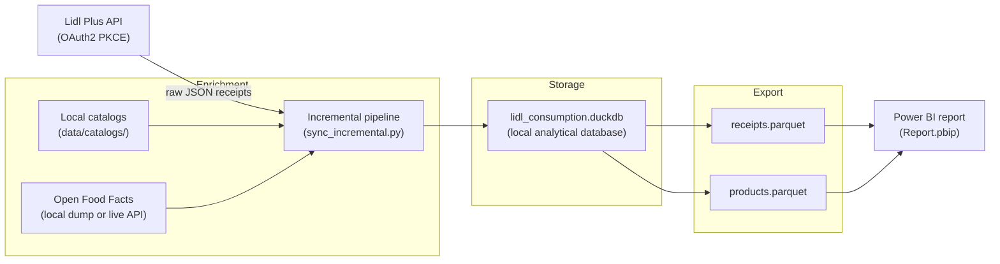

# Lidl Spending & Nutrition

A local, privacy-first data pipeline and dashboard for **Lidl Plus digital receipts**.
It downloads your receipts, matches the products against store catalogs and Open Food
Facts, checks the nutritional values, and turns everything into a Power BI report about
spending, prices and nutrition.

Everything runs on your own computer. Receipts, prices, the local database and the
local cache are never uploaded anywhere and are excluded from this repository.

> **Independent project. Not affiliated with Lidl.**

---

## Contents

- [What it does](#what-it-does)
- [How it works](#how-it-works)
- [Repository layout](#repository-layout)
- [Requirements](#requirements)
- [Quick start on Windows](#quick-start-on-windows)
- [Manual setup (any OS)](#manual-setup-any-os)
- [Lidl authentication](#lidl-authentication)
- [Configuration](#configuration)
- [Local data and privacy](#local-data-and-privacy)
- [Power BI report](#power-bi-report)
- [Optional AI enrichment](#optional-ai-enrichment)
- [Running the tests](#running-the-tests)
- [Troubleshooting](#troubleshooting)

---

## What it does

1. **Downloads receipts** from the Lidl Plus API using OAuth2 (PKCE) and a refresh
   token stored only in your local `.env`.
2. **Unpacks barcodes** (EAN-13 and EAN-8, GS1 checksum) into numeric product keys.
3. **Matches products** against a localized catalog shipped in `data/catalogs/` and,
   when needed, against the Open Food Facts API.
4. **Validates nutrition labels** with an Atwater consistency check, so impossible
   calorie/macro combinations are flagged instead of silently accepted.
5. **Computes Nutri-Score** (the 2023 algorithm) for the products that have complete
   nutrition data.
6. **Stores everything in DuckDB** and exports two compact Parquet files for Power BI:
   `receipts.parquet` (purchases) and `products.parquet` (product catalog).
7. **Lets you review and correct products** in a local Streamlit control panel, with
   optional AI suggestions from Groq.
8. **Visualizes the result** in a Power BI Project (PBIP) with pages for spending,
   quantities, categories, Nutri-Score and a drillthrough product table.

---

## How it works



The Streamlit panel (`app.py`) sits on top of the same services: it starts the
pipeline, shows progress, and lets you review incomplete products.

---

## Repository layout

```text
.
├── app.py                     Streamlit control panel
├── app_settings.py            AI settings stored in the local .env
├── auth_login.py              Lidl Plus OAuth2 PKCE login wizard
├── pipeline_services.py       Services used by the app (sync, review, exports)
├── sync_incremental.py        The incremental ELT pipeline
├── patch_catalog_seed.py      Maintenance helper for the catalog seed
├── ai_enrichment/             Optional Groq enrichment and chatbot batch logic
├── ai_eval/                   Isolated evaluation harness for AI prompts
├── product_store/             Product tables, schema and review services
├── data/catalogs/             Localized catalog seed and taxonomy (public data)
├── dim_inflatie.csv           Monthly food inflation series used by the model
├── tests/                     Offline unit and contract tests
├── .streamlit/config.toml     Streamlit theme and viewer toolbar
├── run.bat                    One-click Windows launcher
├── Report.pbip                Power BI Project entry point
├── Report.Report/             Power BI report definition (PBIR)
└── Report.SemanticModel/      Power BI semantic model (TMDL)
```

Generated at runtime and **not** in the repository:

```text
.env                     your tokens and API keys
lidl_consumption.duckdb  local database
receipts.parquet         fact table exported for Power BI
products.parquet         product dimension exported for Power BI
review_queue.csv         products waiting for review
catalog_overrides.csv    your manual product corrections
data/raw_tickets/        raw receipt JSON files
```

---

## Requirements

- **Python 3.10 or newer**
- Visual C++ Redistributable 2015
- Windows for the one-click `run.bat` launcher (the app itself is cross-platform)
- A **Lidl Plus account** in a supported country (`ro`, `de`, `fr`, `es`, `it`, `pl`, …)
- Internet access for the first login and for synchronization
- **Power BI Desktop** to open and edit the report (optional, but needed for the dashboard)

---

## Quick start on Windows

1. Clone the repository:
   ```bat
   git clone https://github.com/andreidoros/lidl-spending-nutrition.git
   cd lidl-spending-nutrition
   ```
2. Double-click **`run.bat`**.

The launcher will:

- create an isolated `.venv` virtual environment if it does not exist;
- install the packages from `requirements.txt` when they are missing;
- start the official Lidl Plus login wizard if `.env` has no valid token;
- open the control panel at `http://127.0.0.1:8501`, bound to your computer only.

**Startup behaviour**

- Does **not** start synchronization automatically. The pipeline runs only after you
  click **Sync**.
- Binds to `127.0.0.1` only.

Keep the launcher window open while you use the app; press `Ctrl+C` in that window to
stop it.

Sync is an explicit button in the app. Page loads and reruns never start the pipeline.
Each Sync checks every available receipt-history page and downloads only receipts
that are not already stored locally. This lets a later retry recover older receipts
if an earlier download was interrupted. Review and export-retry actions are disabled
while Sync is running.

> The first synchronization can take a while: it downloads the receipts, resolves
> barcodes and queries Open Food Facts for products that are missing nutrition data.

---

## Manual setup (any OS)

```bash
python -m venv .venv

# Linux / macOS
source .venv/bin/activate

# Windows PowerShell
.\.venv\Scripts\Activate.ps1

pip install -r requirements.txt
```

Authenticate once (see the next section), then start the app:

```bash
python -m streamlit run app.py --server.address 127.0.0.1 --server.port 8501
```

For command-line-only use you can still run the pipeline directly:

```bash
python sync_incremental.py
```

---

## Lidl authentication

Synchronization needs a Lidl Plus refresh token. The token is written to `.env`,
which is ignored by Git.

```bash
python auth_login.py
```

1. The script opens the official Lidl Plus login page in your default browser.
2. Log in and confirm the SMS code if requested.
3. The refresh token is saved in `.env` as `LIDL_REFRESH_TOKEN`.

The app never asks for your Lidl password. Re-run the wizard whenever the token
expires or you change your Lidl account.

---

## Configuration

Copy `.env.example` to `.env` and adjust the optional values:

| Variable | Default | Description |
| :--- | :---: | :--- |
| `LIDL_REFRESH_TOKEN` | *required* | OAuth2 refresh token used to download receipts. |
| `LIDL_COUNTRY` | *auto* | Two-letter country code (`ro`, `de`, `fr`, `es`, `it`, `pl`, …). Detected from the token when omitted. |
| `LIDL_LANGUAGE` | *auto* | Explicit reporting language (`en`, `ro`, `de`, …). Defaults to the country language. |
| `OFF_MODE` | `auto` | `auto` uses a local `food.parquet` if present, otherwise the live Open Food Facts API. `parquet` and `api` force one mode. |
| `OFF_NOT_FOUND_TTL_DAYS` | `30` | Days before a product marked `NOT_FOUND_OFF` is queried again. |
| `AI_ENRICHMENT_MODE` | `off` | `off`, `categories`, or `categories_and_nutrition`. |
| `AI_ENRICHMENT_BATCH_SIZE` | `20` | Number of products sent per AI request. |
| `GROQ_API_KEY` | *empty* | Required only when AI enrichment is enabled. |

Never commit `.env`. The repository already ignores it.

---

## Local data and privacy

This project is designed so that **your shopping history never leaves your computer**:

- Receipts, prices, product corrections and the DuckDB database are local files.
- `.gitignore` excludes `.env`, `*.parquet`, `*.duckdb`, `data/raw_tickets/`,
  `review_queue.csv`, `catalog_overrides.csv`, `ai_chat_batch.txt` and Power BI caches.
- The Streamlit app binds to `127.0.0.1`, so it is not reachable from your network.
- The only outbound requests are to Lidl (to download your receipts), Open Food Facts
  (to look up public product data), and Groq (only if you enable AI enrichment).

The repository itself contains only code, tests, public catalog data, the inflation
series and the Power BI definitions.

---

## Power BI report

The report is stored as a **Power BI Project (PBIP)**, which means the report and the
semantic model are plain text files that Git can track. Future report edits can
therefore be committed and pushed like code.

### 1. Generate the data files first

The model reads `receipts.parquet` and `products.parquet` from a local folder. Those
files do not exist until you run at least one synchronization:

- Start the app, connect your Lidl account and click **Sync**, **or**
- run `python sync_incremental.py`.

Both files are created in the project root, next to `app.py`.

### 2. Edit the `Project folder path` parameter

**This step is required.** The report ships with a placeholder path, so it will show
an error until you point it at your own project folder.

1. Open **`Report.pbip`** in Power BI Desktop.
2. Go to **Home → Transform data → Edit parameters** (in Power Query: **Home → Manage
   Parameters**).
3. Select the parameter **`Project folder path`**.
4. Set **Current Value** to the absolute path of the folder that contains
   `receipts.parquet`, `products.parquet` and `dim_inflatie.csv` — for example:
   ```text
   C:\Users\your-name\Documents\lidl-spending-nutrition
   ```
   Use the folder path only. Do not include a file name and do not add a trailing
   backslash.
5. Click **OK**, then **Close & Apply** (or **Refresh**).

> **This edit is local configuration.** Changing the parameter writes your folder path
> into `Report.SemanticModel/definition/expressions.tmdl`, which is tracked by Git.
> Keep the change in your working copy, but do **not** commit or push it — the public
> repository should keep the placeholder path.

The parameter is used by three queries:

```text
"Project folder path" & "\receipts.parquet"
"Project folder path" & "\products.parquet"
"Project folder path" & "\dim_inflatie.csv"
```

If you later move or rename the project folder, edit the parameter again. This is the
only manual step needed to make the report work on a new computer.

### 3. Explore the report

The report opens on **Spend & Quantity**. The other pages cover categories and
Nutri-Score, average receipt value, a spend tree, a drillthrough product table and
tooltip pages.

### 4. Keep editing in Git

- Open `Report.pbip` from your cloned repository.
- Make your changes in Power BI Desktop and save.
- Commit the changed files under `Report.Report/` and `Report.SemanticModel/`.

Do not commit `.pbi/localSettings.json` or `.pbi/cache.abf`; they contain local state
and are already ignored.

---

## Optional AI enrichment

AI enrichment is **off by default**. When enabled, the app can suggest missing
categories and nutrition values for incomplete products. Only the product name, barcode
and package weight are sent — never receipts, prices or purchase history.

1. Create a free Groq API key.
2. Add it to `.env`:
   ```text
   GROQ_API_KEY=your-key
   AI_ENRICHMENT_MODE=categories_and_nutrition
   ```
3. Open **AI settings** in the app and save.

The app always shows AI suggestions for review before saving them. You can reject any
suggestion, and you can run the app entirely without AI.

`ai_eval/` contains an isolated evaluation harness used to compare prompts and models.
It is not part of the production path.

---

## Running the tests

The suite is offline and deterministic: it uses in-memory DuckDB databases and mocked
network adapters.

```bash
python -m unittest discover -s tests -v
```

The tests cover the pipeline stages, product review rules, settings, the Streamlit
contracts and the Windows launcher. No Lidl account, API key or network access is
needed.

---

## Troubleshooting

**The app does not start on port 8501.**
Another program is already using the port. Stop it or change the port in `run.bat` and
in the manual command.

**Sync fails with an authentication error.**
The refresh token expired. Run `python auth_login.py` again.

**Power BI shows an error about `receipts.parquet`.**
Either the file does not exist yet (run a sync) or `Project folder path` points to the
wrong folder. Edit the parameter as described above.

**Some products have no nutrition values.**
Open **Review products** in the app. Incomplete products are listed with the missing
fields; you can fill them in manually or let AI suggest values.

**The report opens but charts are empty.**
Refresh the model after changing the parameter, and make sure the slicers are not
filtering out all dates.

---

## Disclaimer

This is an independent personal project. It is not affiliated with, endorsed by or
sponsored by Lidl. Lidl and Lidl Plus are trademarks of their respective owners.
Product data from Open Food Facts is available under the ODbL license.
